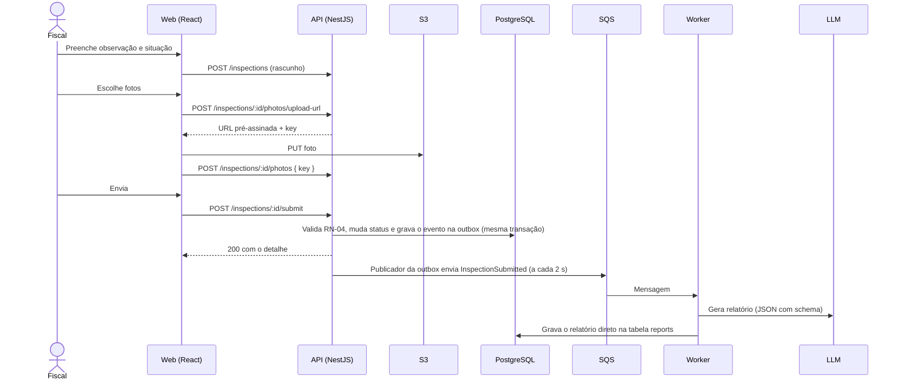
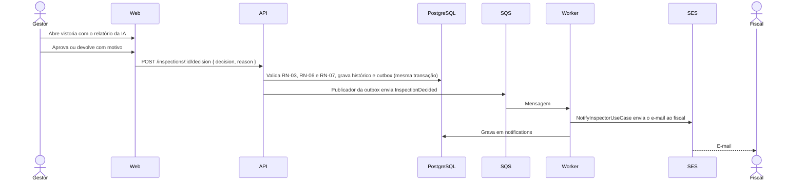
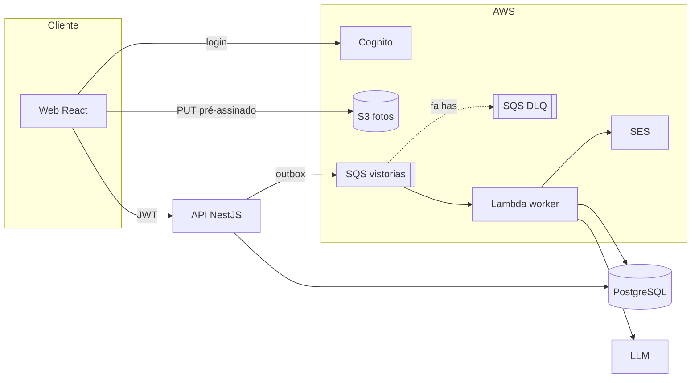

# Fiscaliza

Sistema de vistoria de obras para portfólio. O fiscal registra a vistoria com fotos e observações, a IA gera um relatório padronizado com as não conformidades e o gestor aprova ou devolve.

Este arquivo é a fonte única do projeto: escopo, regras, arquitetura, padrões, design system e plano de execução. Qualquer agente de IA que trabalhar no repositório lê este arquivo primeiro.

> Nota sobre nomes: os documentos (este arquivo, specs, planos e tarefas) usam os termos do domínio em português, como Vistoria, Obra e Fiscal. No código, os nomes seguem o glossário da seção 10 de `specs/constitution.md` (`Inspection`, `ConstructionSite`, `Role.INSPECTOR`). Nas seções 5, 11 a 14, 16.4 e 21 a 26 os identificadores já aparecem como estão no código; os exemplos de código da seção 9 e os nomes de pastas das seções 9, 16 e 18 ainda estão em português e devem ser lidos pelo glossário.

---

## Sumário

1. [Objetivo](#1-objetivo)
2. [Escopo](#2-escopo)
3. [Perfis e permissões](#3-perfis-e-permissões)
4. [Regras de negócio](#4-regras-de-negócio)
5. [Fluxos](#5-fluxos)
6. [Stack](#6-stack)
7. [Arquitetura geral](#7-arquitetura-geral)
8. [Estrutura do monorepo](#8-estrutura-do-monorepo)
9. [Back-end: camadas](#9-back-end-camadas)
10. [Padrões de projeto](#10-padrões-de-projeto)
11. [Modelo de dados](#11-modelo-de-dados)
12. [API REST](#12-api-rest)
13. [Processamento assíncrono](#13-processamento-assíncrono)
14. [IA: geração do relatório](#14-ia-geração-do-relatório)
15. [Autenticação](#15-autenticação)
16. [Front-end: camadas](#16-front-end-camadas)
17. [Design system](#17-design-system)
18. [Pacote compartilhado](#18-pacote-compartilhado)
19. [Convenções de código](#19-convenções-de-código)
20. [Testes](#20-testes)
21. [Ambiente local e Docker](#21-ambiente-local-e-docker)
22. [CI/CD e deploy](#22-cicd-e-deploy)
23. [Observabilidade](#23-observabilidade)
24. [Segurança](#24-segurança)
25. [Spec-Driven Development](#25-spec-driven-development)
26. [Servidor MCP](#26-servidor-mcp)
27. [Custos](#27-custos)
28. [Plano de execução](#28-plano-de-execução)
29. [Ferramentas de IA e o Ponytail](#29-ferramentas-de-ia-e-o-ponytail)
30. [Apresentação](#30-apresentação)
31. [Checklist de pronto](#31-checklist-de-pronto)

---

## 1. Objetivo

| Item | Descrição |
|---|---|
| Para quem | Recrutadores e entrevistadores técnicos de uma vaga Full Stack Pleno (React, NestJS, AWS, LLMs, SDD) |
| O que prova | Domínio da stack, organização em camadas, padrões de projeto, processo guiado por spec e interesse pelo domínio (fiscalização de obras) |
| Tamanho | Pequeno de propósito: 6 funcionalidades, 5 a 7 dias |
| Princípio | Cada tecnologia resolve um problema real do sistema. Nada entra só para constar |

---

## 2. Escopo

### Dentro do MVP

| # | Funcionalidade | Perfil |
|---|---|---|
| F1 | Login e perfis | Todos |
| F2 | Cadastro e listagem de obras | Gestor |
| F3 | Registro de vistoria com observação, fotos e situação | Fiscal |
| F4 | Relatório gerado por IA (resumo, não conformidades e gravidade) | Sistema |
| F5 | Aprovação ou devolução da vistoria, com notificação | Gestor |
| F6 | Painel de vistorias por obra e por status | Gestor |

### Fora do MVP (não fazer)

- App mobile e modo offline (citar como próximo passo).
- Medição financeira, aditivos e cronograma.
- Cadastro de usuários pela tela (usuários criados direto no Cognito).
- Multiempresa, relatórios em PDF e assinatura digital.

---

## 3. Perfis e permissões

| Ação | Fiscal | Gestor |
|---|:-:|:-:|
| Ver obras | Só as atribuídas a ele | Todas |
| Criar e editar obra | | ✓ |
| Atribuir fiscal à obra | | ✓ |
| Criar vistoria | ✓ (em obra atribuída) | |
| Editar vistoria | ✓ (em rascunho ou devolvida) | |
| Enviar vistoria | ✓ | |
| Aprovar ou devolver | | ✓ |
| Ver painel | | ✓ |

O perfil vem do grupo do Cognito (`fiscal` ou `gestor`). A regra "só as obras atribuídas" fica no caso de uso, consultando o banco, nunca só no front.

---

## 4. Regras de negócio

Cada regra tem código, que aparece na spec, no teste e na mensagem de erro.

| Código | Regra |
|---|---|
| RN-01 | Uma vistoria pertence a uma obra e a um fiscal atribuído a essa obra |
| RN-02 | Status possíveis: `RASCUNHO`, `ENVIADA`, `APROVADA`, `DEVOLVIDA` |
| RN-03 | Transições válidas: RASCUNHO → ENVIADA; ENVIADA → APROVADA; ENVIADA → DEVOLVIDA; DEVOLVIDA → ENVIADA |
| RN-04 | Só é possível enviar com observação de no mínimo 30 caracteres e pelo menos 1 foto |
| RN-05 | Máximo de 10 fotos por vistoria, JPEG, PNG ou WebP, até 10 MB cada |
| RN-06 | Devolver exige motivo (mínimo 10 caracteres) |
| RN-07 | Vistoria `APROVADA` não pode ser alterada |
| RN-08 | O relatório da IA é uma sugestão: o gestor decide e o sistema registra quem decidiu |
| RN-09 | Toda mudança de status gera um registro no histórico (quem, quando, de qual para qual status) |
| RN-10 | Obra encerrada não recebe vistoria nova |

---

## 5. Fluxos

### 5.1 Criar e enviar vistoria



O worker não chama a API: ele grava no banco pelo cliente Prisma gerado do schema da API (o `schema.prisma` tem um segundo gerador, `worker`). Assim os dois nunca divergem. A API lê o relatório da mesma tabela quando o fiscal ou o gestor abre a vistoria.

### 5.2 Aprovar ou devolver



A notificação é só por e-mail. Não existe aviso dentro do sistema. O "consumidor de notificações" é o próprio worker, no caso de uso `NotifyInspectorUseCase`, e o envio usa a API v1 do SES (`@aws-sdk/client-ses`) porque o LocalStack da comunidade não implementa a v2.

---

## 6. Stack

| Camada | Tecnologia | Por quê |
|---|---|---|
| Linguagem | TypeScript (strict) em tudo | Um idioma do banco à tela |
| Back-end | NestJS 11, Node 22 | Pedido da vaga; DI e módulos |
| ORM | Prisma + PostgreSQL 16 | Tipagem gerada e migrações |
| Validação | Zod (pacote compartilhado) + pipe do Nest | Mesmo schema no front e no back |
| Front-end | React 19 + Vite, React Router, TanStack Query, React Hook Form | Painel logado não precisa de SSR |
| Estilo | Tailwind CSS 4 + componentes próprios no padrão shadcn/ui | Design system em tokens |
| Arquivos | AWS S3 (LocalStack no dev) | Upload por URL pré-assinada |
| Fila | AWS SQS (LocalStack no dev) | Desacoplar a geração do relatório |
| Worker | AWS Lambda (no dev, processo Node consumindo a fila) | Processamento sob demanda |
| Auth | AWS Cognito (User Pool com grupos) | Pedido da vaga |
| Notificação | AWS SES (e-mail, API v1) | Pedido da vaga |
| LLM | Gemini (principal) + reserva configurável | Cota gratuita e fallback |
| Containers | Docker + docker-compose | Ambiente igual em qualquer máquina |
| Monorepo | pnpm workspaces | Pacote compartilhado sem publicar |
| CI | GitHub Actions | Lint, testes e build |
| Docs da API | Swagger (`@nestjs/swagger`) | Contrato gerado do código |

---

## 7. Arquitetura geral



Decisões:

- **Monolito modular na API**, com o worker separado. Separar mais serviços seria complexidade sem ganho para este tamanho. O worker é separado porque tem outro ritmo (lento, depende da IA) e escala diferente.
- **Arquivo nunca passa pela API**: a API só assina a URL e guarda a chave.
- **Comunicação assíncrona** entre API e worker, com outbox para não perder evento.

---

## 8. Estrutura do monorepo

```
fiscaliza/
├─ apps/
│  ├─ api/              NestJS
│  ├─ web/              React + Vite
│  ├─ worker/           consumidor da fila (roda como Lambda ou processo local)
│  └─ mcp/              servidor MCP (diferencial)
├─ packages/
│  ├─ shared/           schemas Zod, tipos, enums e códigos de erro
│  └─ config/           eslint, tsconfig e prettier compartilhados
├─ specs/               SDD: constitution, specs, planos e tarefas
├─ docs/
│  ├─ adr/              decisões de arquitetura
│  └─ diagramas/
├─ infra/
│  ├─ localstack/       script que cria bucket e filas
│  └─ aws/              notas ou IaC da conta real
├─ docker-compose.yml
├─ CLAUDE.md            regras para agentes de IA (aponta para este arquivo)
├─ PROJETO.md           este arquivo
└─ README.md
```

---

## 9. Back-end: camadas

### 9.1 A regra de dependência

```
presentation  →  application  →  domain
infrastructure  →  application, domain
```

- **domain** não importa nada de fora: nem Nest, nem Prisma, nem AWS.
- **application** conhece o domínio e as **portas** (interfaces). Não sabe qual banco ou fila existe.
- **infrastructure** implementa as portas (Prisma, S3, SQS, LLM).
- **presentation** recebe HTTP, valida e chama o caso de uso.
- O Nest só "cola" as peças no arquivo `*.module.ts`.

Interface só onde existe troca real: repositórios, armazenamento, fila, LLM e relógio. Sem interface para tudo.

### 9.2 Estrutura de um módulo

```
apps/api/src/
├─ main.ts
├─ app.module.ts
├─ shared/                       infraestrutura transversal
│  ├─ config/                    ConfigModule validado com Zod
│  ├─ database/                  PrismaService
│  ├─ auth/                      JwtGuard, PerfilGuard, @Perfis, @Usuario
│  ├─ errors/                    DomainError, filtro global de exceção
│  ├─ logging/                   logger JSON, interceptor de correlation id
│  └─ outbox/                    tabela, repositório e publicador
└─ modules/
   └─ vistorias/
      ├─ domain/
      │  ├─ vistoria.entity.ts           estado e regras (RN-03, RN-04, RN-07)
      │  ├─ status-vistoria.ts           enum + mapa de transições
      │  ├─ foto.value-object.ts
      │  └─ vistoria.errors.ts           erros com código RN-xx
      ├─ application/
      │  ├─ ports/
      │  │  ├─ vistoria.repository.ts    interface
      │  │  └─ armazenamento.port.ts     interface
      │  ├─ criar-vistoria.use-case.ts
      │  ├─ enviar-vistoria.use-case.ts
      │  ├─ decidir-vistoria.use-case.ts
      │  └─ gerar-url-upload.use-case.ts
      ├─ infrastructure/
      │  ├─ prisma-vistoria.repository.ts
      │  ├─ vistoria.mapper.ts           banco ⇄ entidade
      │  └─ s3-armazenamento.adapter.ts
      ├─ presentation/
      │  ├─ vistorias.controller.ts
      │  └─ dtos/                        criados a partir dos schemas do shared
      └─ vistorias.module.ts
```

Módulos: `auth`, `obras`, `vistorias`, `relatorios`, `notificacoes`, `painel`.

### 9.3 O que vai em cada camada

| Camada | Pode | Não pode |
|---|---|---|
| domain | Regras, validações de negócio, transições de estado, erros de domínio | Importar Nest, Prisma, AWS, HTTP |
| application | Orquestrar: buscar, chamar o domínio, salvar, publicar evento | Conhecer status HTTP, SQL ou SDK da AWS |
| infrastructure | SQL, SDKs, mapeamento, retry | Regra de negócio |
| presentation | Rota, DTO, guard, Swagger, converter para resposta | Regra de negócio, acesso direto ao banco |

### 9.4 Exemplos de referência

**Entidade (domain)**

```ts
export class Vistoria {
  private constructor(private props: VistoriaProps) {}

  static criar(dados: NovaVistoria): Vistoria {
    return new Vistoria({ ...dados, status: StatusVistoria.RASCUNHO, fotos: [] });
  }

  enviar(): void {
    if (this.props.observacao.length < 30 || this.props.fotos.length === 0) {
      throw new VistoriaIncompletaError();             // RN-04
    }
    this.mudarStatus(StatusVistoria.ENVIADA);
  }

  private mudarStatus(novo: StatusVistoria): void {
    if (!podeTransicionar(this.props.status, novo)) {
      throw new TransicaoInvalidaError(this.props.status, novo); // RN-03
    }
    this.props.status = novo;
  }
}
```

**Porta (application)**

```ts
export interface VistoriaRepository {
  buscarPorId(id: string): Promise<Vistoria | null>;
  salvar(vistoria: Vistoria): Promise<void>;
}
export const VISTORIA_REPOSITORY = Symbol('VISTORIA_REPOSITORY');
```

**Caso de uso (application)**

```ts
@Injectable()
export class EnviarVistoriaUseCase {
  constructor(
    @Inject(VISTORIA_REPOSITORY) private readonly vistorias: VistoriaRepository,
    private readonly outbox: Outbox,
    private readonly tx: UnidadeDeTrabalho,
  ) {}

  async executar(id: string, fiscalId: string): Promise<void> {
    const vistoria = await this.vistorias.buscarPorId(id);
    if (!vistoria) throw new VistoriaNaoEncontradaError(id);
    vistoria.garantirDono(fiscalId);                    // RN-01
    vistoria.enviar();

    await this.tx.executar(async () => {
      await this.vistorias.salvar(vistoria);
      await this.outbox.registrar('VistoriaEnviada', { vistoriaId: id });
    });
  }
}
```

**Controller (presentation)**

```ts
@Controller('vistorias')
@UseGuards(JwtGuard, PerfilGuard)
export class VistoriasController {
  constructor(private readonly enviar: EnviarVistoriaUseCase) {}

  @Post(':id/enviar')
  @Perfis('fiscal')
  @HttpCode(204)
  async enviarVistoria(@Param('id', ParseUUIDPipe) id: string, @Usuario() u: UsuarioAutenticado) {
    await this.enviar.executar(id, u.id);
  }
}
```

**Ligação no módulo**

```ts
@Module({
  controllers: [VistoriasController],
  providers: [
    EnviarVistoriaUseCase,
    { provide: VISTORIA_REPOSITORY, useClass: PrismaVistoriaRepository },
    { provide: ARMAZENAMENTO, useClass: S3ArmazenamentoAdapter },
  ],
})
export class VistoriasModule {}
```

### 9.5 Erros

- O domínio lança `DomainError` com `codigo` (ex.: `RN-04`) e mensagem em português.
- Um filtro global converte para HTTP: não encontrado → 404, sem permissão → 403, regra violada → 422, entrada inválida → 400.
- O formato da resposta de erro está na seção 12.3.

---

## 10. Padrões de projeto

Só os que resolvem algo aqui. Cada um vira assunto na entrevista.

| Padrão | Onde | Problema que resolve |
|---|---|---|
| Repository | `VistoriaRepository` e implementação Prisma | Regra de negócio sem SQL; teste com repositório em memória |
| Ports and Adapters | Armazenamento (S3 ou LocalStack), fila, LLM | Trocar infraestrutura sem mexer no caso de uso |
| Use Case (Command) | Uma classe por ação | Ação com nome de negócio, fácil de testar e achar |
| State | Mapa de transições do status | RN-03 num só lugar, sem `if` espalhado |
| Strategy + Chain of Responsibility | `LlmProvider` com principal e reserva | Fallback quando a cota acaba ou o serviço cai |
| Transactional Outbox | `shared/outbox` | Salvar a vistoria e o evento juntos, sem perder mensagem |
| Mapper | `vistoria.mapper.ts` | Modelo do banco separado da entidade |
| Unit of Work | `UnidadeDeTrabalho` sobre `prisma.$transaction` | Várias escritas atômicas |
| Decorator | `@Perfis`, `@Usuario` | Autorização declarativa na rota |
| Dependency Injection | Container do Nest | Baixo acoplamento |

---

## 11. Modelo de dados

Este é o `apps/api/prisma/schema.prisma` como está hoje, sem os blocos `generator` e `datasource`. Os nomes são em inglês (glossário da seção 10 da constitution) e cada modelo vira uma tabela em `snake_case` pelo `@@map`. O diagrama está em `docs/diagramas/modelo-de-dados.md`.

```prisma
enum Role {
  INSPECTOR
  MANAGER
}

model User {
  // Cognito sub
  id    String @id
  name  String
  email String @unique
  role  Role

  assignments   SiteAssignment[]
  inspections   Inspection[]
  statusChanges InspectionStatusHistory[]
  notifications Notification[]

  @@map("users")
}

model ConstructionSite {
  id          String           @id @default(uuid())
  name        String
  contract    String           @unique
  address     String
  closed      Boolean          @default(false)
  createdAt   DateTime         @default(now())
  assignments SiteAssignment[]
  inspections Inspection[]

  // Trigram indexes serve the "contains" search (ILIKE '%x%'), which a btree cannot
  @@index([name(ops: raw("gin_trgm_ops"))], type: Gin)
  @@index([contract(ops: raw("gin_trgm_ops"))], type: Gin)
  @@map("construction_sites")
}

model SiteAssignment {
  constructionSiteId String
  inspectorId        String
  constructionSite   ConstructionSite @relation(fields: [constructionSiteId], references: [id], onDelete: Cascade)
  inspector          User             @relation(fields: [inspectorId], references: [id])

  @@id([constructionSiteId, inspectorId])
  @@index([inspectorId])
  @@map("site_assignments")
}

enum Compliance {
  COMPLIANT
  NON_COMPLIANT
}

enum InspectionStatus {
  DRAFT
  SUBMITTED
  APPROVED
  RETURNED
}

model Inspection {
  id                 String                    @id @default(uuid())
  constructionSiteId String
  inspectorId        String
  notes              String
  compliance         Compliance
  status             InspectionStatus          @default(DRAFT)
  returnReason       String?
  createdAt          DateTime                  @default(now())
  updatedAt          DateTime                  @updatedAt
  constructionSite   ConstructionSite          @relation(fields: [constructionSiteId], references: [id])
  inspector          User                      @relation(fields: [inspectorId], references: [id])
  photos             Photo[]
  history            InspectionStatusHistory[]
  report             Report?
  notifications      Notification[]

  @@index([constructionSiteId, status])
  @@index([inspectorId])
  @@map("inspections")
}

model Photo {
  id           String     @id @default(uuid())
  inspectionId String
  // S3 object key
  key          String     @unique
  contentType  String
  size         Int
  inspection   Inspection @relation(fields: [inspectionId], references: [id], onDelete: Cascade)

  @@index([inspectionId])
  @@map("photos")
}

model InspectionStatusHistory {
  id           String            @id @default(uuid())
  inspectionId String
  from         InspectionStatus?
  to           InspectionStatus
  userId       String
  at           DateTime          @default(now())
  // Why it was returned (RN-06); null in every other change
  reason       String?
  inspection   Inspection        @relation(fields: [inspectionId], references: [id], onDelete: Cascade)
  // The timeline shows who changed the status by name
  user         User              @relation(fields: [userId], references: [id])

  @@index([inspectionId, at])
  @@map("inspection_status_history")
}

enum Severity {
  LOW
  MEDIUM
  HIGH
}

// Written by the worker (spec 004); the API only reads it. One row per inspection,
// replaced when a returned inspection is submitted again
model Report {
  id              String     @id @default(uuid())
  inspectionId    String     @unique
  summary         String
  // [{ item, description, severity }], validated by aiReportSchema before it is stored
  nonConformities Json
  severity        Severity
  // LLM that produced it, e.g. gemini-2.5-flash or stub
  model           String
  // Id of the event that generated it: a redelivered message finds it and does nothing
  eventId         String     @unique
  generatedAt     DateTime
  inspection      Inspection @relation(fields: [inspectionId], references: [id], onDelete: Cascade)

  @@map("reports")
}

// Transactional outbox: written with the status change, published to the queue afterwards
model OutboxEvent {
  // Same as the envelope id
  id          String    @id @default(uuid())
  type        String
  // The whole envelope, as it goes to the queue
  payload     Json
  createdAt   DateTime  @default(now())
  publishedAt DateTime?
  attempts    Int       @default(0)

  // The publisher reads the pending ones in creation order
  @@index([publishedAt, createdAt])
  @@map("outbox_events")
}

// Written by the worker (spec 005): one row per e-mail sent, unique by the event that caused
// it, so a redelivered message finds it and sends nothing
model Notification {
  id           String     @id @default(uuid())
  eventId      String     @unique
  // The inspector who is told
  userId       String
  inspectionId String
  // EMAIL for now
  channel      String
  subject      String
  sentAt       DateTime
  user         User       @relation(fields: [userId], references: [id])
  inspection   Inspection @relation(fields: [inspectionId], references: [id], onDelete: Cascade)

  @@index([userId])
  @@map("notifications")
}
```

Pontos que importam:

- `Report.eventId` é único: guarda o id do evento que gerou o relatório, e é assim que o worker reconhece uma mensagem repetida (seção 13.3). Há uma linha por vistoria; um reenvio depois de devolvida a substitui.
- `InspectionStatusHistory.reason` guarda o motivo da devolução (RN-06) e fica nulo nas outras mudanças.
- `OutboxEvent.payload` guarda o envelope inteiro, como vai para a fila (seção 13.1), e o índice `(publishedAt, createdAt)` serve ao publicador.
- `Notification.eventId` é único pelo mesmo motivo do relatório: uma mensagem repetida não manda o e-mail duas vezes.
- `ConstructionSite` tem índices trigram (`gin_trgm_ops`) em `name` e `contract` para a busca por trecho.
- `Photo`, `InspectionStatusHistory`, `Report` e `Notification` apagam em cascata com a vistoria, e `SiteAssignment` com a obra.

---

## 12. API REST

### 12.1 Endpoints

Prefixo `/api/v1`. Todos exigem JWT (Cognito, ou o token fixo do modo local), menos `/health`.

| Método | Rota | Perfil | Descrição |
|---|---|---|---|
| GET | `/me` | todos | Usuário logado e perfil (cria o registro no primeiro acesso) |
| GET | `/construction-sites` | todos | Lista paginada, com `?search=` e `?closed=` (fiscal vê só as atribuídas) |
| GET | `/construction-sites/:id` | todos | Detalhe com os ids dos fiscais (fiscal só vê as atribuídas; as outras dão 404) |
| POST | `/construction-sites` | gestor | Cria obra |
| PATCH | `/construction-sites/:id` | gestor | Edita ou encerra |
| PUT | `/construction-sites/:id/inspectors` | gestor | Define os fiscais da obra |
| GET | `/users?role=INSPECTOR` | gestor | Fiscais para o seletor da obra |
| GET | `/construction-sites/:id/inspections` | todos | Vistorias da obra, paginadas, com `?status=` |
| POST | `/inspections` | fiscal | Cria rascunho (201) |
| GET | `/inspections/:id` | todos | Detalhe com fotos, relatório e histórico |
| PATCH | `/inspections/:id` | fiscal | Edita rascunho ou devolvida |
| POST | `/inspections/:id/photos/upload-url` | fiscal | Gera URL pré-assinada (valida RN-05) |
| POST | `/inspections/:id/photos` | fiscal | Confirma a foto enviada (`{ key }`) e devolve o detalhe |
| DELETE | `/inspections/:id/photos/:photoId` | fiscal | Remove foto (204) |
| POST | `/inspections/:id/submit` | fiscal | Envia (RN-04) e devolve o detalhe |
| POST | `/inspections/:id/decision` | gestor | `{ decision: "APPROVE" \| "RETURN", reason? }`; `reason` é obrigatório ao devolver (RN-06). Devolve o detalhe |
| GET | `/dashboard` | gestor | Totais por status (`totals`), resumo por obra (`sites`) e vistorias aguardando decisão (`awaitingDecision`) |
| GET | `/health` | público | Saúde da API e do banco (Terminus) |

### 12.2 Convenções

- Paginação: `?page=1&limit=20` (máximo 100), resposta `{ items, total, page, limit }`.
- Filtros por query: `?status=SUBMITTED`.
- Datas em ISO 8601 UTC.
- IDs em UUID.
- Swagger em `/api/docs`.

### 12.3 Formato de erro

```json
{
  "code": "RN-04",
  "message": "A vistoria precisa de observação com 30 caracteres e pelo menos 1 foto para ser enviada.",
  "details": [{ "field": "photos", "problem": "mínimo 1" }],
  "correlationId": "c1a2..."
}
```

Além de `RN-01` a `RN-10`, o código pode ser `VALIDATION_ERROR`, `NOT_FOUND`, `UNAUTHORIZED`, `FORBIDDEN`, `INTERNAL_ERROR` ou um código específico de módulo (`DUPLICATE_CONTRACT`, `CONSTRUCTION_SITE_CLOSED`, `INVALID_INSPECTOR`, `INVALID_PHOTO`). A lista fica em `packages/shared/src/errors/error-codes.ts`.

---

## 13. Processamento assíncrono

### 13.1 Eventos

| Evento | Quando | Consumidor |
|---|---|---|
| `InspectionSubmitted` | Fiscal envia | Worker: `GenerateReportUseCase` gera o relatório com IA |
| `InspectionDecided` | Gestor aprova ou devolve | Worker: `NotifyInspectorUseCase` avisa o fiscal por e-mail |

Formato padrão da mensagem (`eventEnvelopeSchema`, em `packages/shared`):

```json
{ "id": "uuid", "type": "InspectionSubmitted", "version": 1, "occurredAt": "2026-10-23T12:00:00Z",
  "correlationId": "c1a2...", "data": { "inspectionId": "uuid" } }
```

Em `InspectionDecided`, `data` traz `inspectionId`, `decision` (`APPROVE` ou `RETURN`), `reason` (nulo ao aprovar) e `decidedBy`.

### 13.2 Outbox

1. O caso de uso grava a mudança e o evento na tabela `outbox_events` (`OutboxEvent`), na mesma transação (`UnitOfWork`).
2. O `OutboxPublisher`, uma tarefa dentro da API, roda a cada 2 s. Em cada ciclo abre uma transação e lê até 20 eventos pendentes (`publishedAt IS NULL` e menos de 10 tentativas) com `FOR UPDATE SKIP LOCKED`, então duas instâncias da API não pegam a mesma linha. Envia cada um ao SQS e marca `publishedAt`.
3. Se o envio falhar, soma `attempts` e tenta de novo no ciclo seguinte. Depois de 10 tentativas o evento fica parado na tabela, sem alarme nesta versão.
4. A variável `OUTBOX_PUBLISHER_ENABLED=false` desliga o publicador (os testes fazem isso).

A entrega é pelo menos uma vez, por isso os consumidores são idempotentes (ADR 0005).

### 13.3 Fila e worker

| Configuração | Valor |
|---|---|
| Tipo da fila | Standard |
| Visibility timeout | 120 s (maior que o tempo máximo de geração) |
| Long polling | 20 s (no poller local) |
| DLQ | Após 3 recebimentos (`maxReceiveCount = 3`) |
| Lote | Poller local: até 5 mensagens por ciclo. Lambda: o `handler` processa os registros do evento um a um e devolve `batchItemFailures` (`ReportBatchItemFailures`), então só os que falharam voltam para a fila |

O worker é **idempotente**: se já existe relatório com aquele `eventId`, ele ignora a mensagem (o mesmo vale para `notifications`). Mensagem malformada lança erro e vai para a DLQ; evento de tipo desconhecido é registrado e descartado.

O `handler` da Lambda e o `local-poller` (que roda no compose e no desenvolvimento) fazem a mesma coisa: transformam a mensagem em texto e chamam `dispatchEvent`. O repositório traz o handler e os testes dele, mas não traz o deploy da Lambda.

Estrutura do worker (mesmas camadas):

```
apps/worker/
├─ prompts/report.v1.md           prompt versionado
└─ src/
   ├─ handler.ts                  entrada da Lambda
   ├─ local-poller.ts             laço de consumo local (compose e dev)
   ├─ dispatch-event.ts           escolhe o caso de uso pelo tipo do evento
   ├─ container.ts, config.ts     montagem e variáveis validadas
   ├─ application/
   │  ├─ generate-report.use-case.ts
   │  ├─ notify-inspector.use-case.ts
   │  ├─ build-report-prompt.ts
   │  └─ ports/                   inspection.reader, llm.provider, notifier, report.repository, notification.repository
   ├─ domain/                     report.ts, clock.ts
   └─ infrastructure/
      ├─ llm/                     gemini.provider, fallback.provider, stub.provider, llm-with-fallback
      ├─ notify/ses-notifier.ts
      └─ database/                prisma-*.repository, prisma-inspection.reader e o cliente gerado
```

---

## 14. IA: geração do relatório

### 14.1 Contrato

Entrada: observação do fiscal, situação marcada, nome da obra e quantidade de fotos.
Saída validada por schema Zod (do pacote `shared`, `packages/shared/src/schemas/report.schema.ts`):

```ts
export const aiReportSchema = z.object({
  summary: z.string().min(20).max(600),
  nonConformities: z.array(z.object({
    item: z.string().max(120),
    description: z.string().max(300),
    severity: z.enum(Severity),   // LOW, MEDIUM ou HIGH
  })).max(10),
  severity: z.enum(Severity),
});
```

### 14.2 Provedores

```ts
export interface LlmProvider {
  readonly name: string;
  generateJson<T>(prompt: string, schema: z.ZodType<T>): Promise<T>;
}
```

Três adapters implementam a porta, escolhidos e ordenados por `LLM_PROVIDERS` (por exemplo `gemini,fallback`):

- `GeminiProvider`: API REST do Gemini (modelo em `GEMINI_MODEL`), com saída JSON pedida pelo schema.
- `FallbackProvider`: qualquer API compatível com OpenAI (Groq, OpenRouter, Ollama), configurada por `FALLBACK_LLM_BASE_URL`, `FALLBACK_LLM_API_KEY` e `FALLBACK_LLM_MODEL`.
- `StubProvider`: relatório determinístico, sem rede nem chave. É o padrão local e a configuração o recusa com `NODE_ENV=production`.

`LlmWithFallback` recebe a lista de provedores em ordem. Resposta inválida (não é JSON ou fora do schema) ganha 1 nova tentativa no mesmo provedor; cota (429), timeout (30 s), erro de rede ou 5xx passam direto para o próximo. Se todos falham, lança erro e a mensagem volta para a fila. O nome do modelo que respondeu vai para `Report.model`.

### 14.3 Regras do prompt

- Papel: assistente técnico de fiscalização de obras.
- Usar só o que está na observação. Não inventar medida, norma ou valor.
- Se a observação não tiver não conformidade, devolver lista vazia.
- Responder só JSON no formato pedido.
- O prompt fica em arquivo versionado (`apps/worker/prompts/report.v1.md`), nunca espalhado no código.

### 14.4 Proteções

- Validação do schema em código. Se falhar, tenta de novo uma vez e depois troca de provedor.
- Limite de tamanho da observação antes de enviar: 2000 caracteres (`MAX_NOTES_FOR_PROMPT`).
- Texto do fiscal tratado como dado: delimitado por `<observation>` no prompt, sem as tags que ele digitar, e nunca seguido como instrução.
- Na tela, o relatório aparece com o selo "Sugestão da IA" (RN-08).

---

## 15. Autenticação

| Item | Configuração |
|---|---|
| User Pool | Login por e-mail e senha |
| Grupos | `fiscal`, `gestor` |
| App client | Sem segredo (SPA), fluxo SRP |
| Front | Biblioteca do Amplify (só o módulo de auth) |
| API | `aws-jwt-verify` validando o access token (emissor, cliente, expiração, assinatura pelo JWKS) |
| Sincronização | No primeiro acesso, `/me` cria o `Usuario` no banco a partir do token (`sub`, e-mail, grupo) |
| Desenvolvimento | Variável `AUTH_MODE=local` libera um guard falso com usuários de teste, para rodar sem AWS |

---

## 16. Front-end: camadas

### 16.1 Estrutura por funcionalidade

```
apps/web/src/
├─ app/
│  ├─ router.tsx               rotas e proteção por perfil
│  ├─ providers.tsx            QueryClient, auth, tema
│  └─ layout/                  AppShell, Sidebar, Topbar
├─ design-system/              tokens e componentes base (seção 17)
│  ├─ tokens.css
│  └─ components/              Button, Input, Select, Badge, Card, Dialog, Table, Toast, Skeleton, EmptyState
├─ features/
│  ├─ obras/
│  │  ├─ api/obras.api.ts      chamadas HTTP (só isso)
│  │  ├─ hooks/use-obras.ts    TanStack Query (cache, loading, invalidação)
│  │  ├─ components/           ObraCard, ObraForm
│  │  └─ pages/                ObrasPage, ObraDetalhePage
│  ├─ vistorias/
│  │  ├─ api/
│  │  ├─ hooks/                use-vistoria, use-enviar-vistoria, use-upload-foto
│  │  ├─ components/           VistoriaForm, FotoUploader, StatusBadge, RelatorioIa, HistoricoTimeline
│  │  ├─ utils/                pode-editar.ts (regras de exibição)
│  │  └─ pages/
│  ├─ painel/
│  └─ auth/
├─ lib/
│  ├─ http.ts                  cliente com token, correlation id e tratamento de erro
│  └─ formatar.ts              datas e números
└─ main.tsx
```

### 16.2 Responsabilidade de cada peça

| Peça | Faz | Não faz |
|---|---|---|
| `api/` | Chama a API e devolve dados tipados | Estado, JSX |
| `hooks/` | Cache, loading, erro, mutações e invalidação | Markup |
| `pages/` | Junta hooks e componentes de uma rota | Chamada HTTP direta, regra complexa |
| `components/` da feature | Exibe e emite eventos (`onEnviar`) | Buscar dados por conta própria |
| `design-system/` | Visual e acessibilidade genéricos | Conhecer "vistoria" ou "obra" |
| `utils/` | Funções puras testáveis | Efeitos colaterais |

### 16.3 Regras de componente limpo

- Um componente, uma responsabilidade. Passou de ~150 linhas, dividir.
- Props tipadas e mínimas. Nada de passar o objeto inteiro quando só usa dois campos.
- Componente de exibição não chama API: recebe dados e callbacks.
- Sem lógica no JSX: condição complexa vira variável com nome (`const podeEnviar = ...`).
- Estados de carregando, vazio e erro em toda lista (Skeleton, EmptyState, mensagem com ação).
- Formulário com React Hook Form + `zodResolver` usando o schema do `shared`.
- Nada de `useEffect` para buscar dado: usar o hook do TanStack Query.

### 16.4 Telas

| Rota | Perfil | Conteúdo | Situação |
|---|---|---|---|
| `/sign-in` | público | Login (usuário de teste no modo local, e-mail e senha no Cognito) | pronta |
| `/` | todos | Redireciona cada perfil para a sua tela inicial | pronta |
| `/construction-sites` | todos | Lista em cards com busca | pronta |
| `/construction-sites/:id` | todos | Dados da obra, fiscais atribuídos e vistorias com filtro por status e paginação | pronta |
| `/dashboard` | gestor | Totais por status, resumo por obra e vistorias aguardando decisão | pronta |
| `/design-system` | só em build de desenvolvimento | Vitrine dos componentes base | pronta |
| `/inspections/new?site=:id` | fiscal | Formulário e upload de fotos | pronta |
| `/inspections/:id` | todos | Detalhe, galeria, relatório da IA, histórico e ações | pronta |

---

## 17. Design system

Visual de prancheta técnica: claro, neutro, com azul de planta baixa como cor principal e cores de status que lembram sinalização de obra.

### 17.1 Tokens de cor

| Token | Claro | Escuro | Uso |
|---|---|---|---|
| `--bg` | `#F5F7FA` | `#0F1520` | Fundo da página |
| `--surface` | `#FFFFFF` | `#161E2C` | Cards, tabelas, modais |
| `--border` | `#DCE2EA` | `#273246` | Bordas e divisórias |
| `--text` | `#18212F` | `#E4E9F1` | Texto principal |
| `--text-muted` | `#5A6577` | `#97A3B6` | Texto secundário |
| `--primary` | `#2152B8` | `#7FA6F5` | Ações principais, links |
| `--primary-fg` | `#FFFFFF` | `#0F1520` | Texto sobre o primário |
| `--success` | `#1E7A4C` | `#6FD19E` | Aprovada, conforme |
| `--warning` | `#9E5E00` | `#F0B467` | Enviada, aguardando |
| `--danger` | `#B3261E` | `#F08A8F` | Devolvida, não conforme, erro |
| `--info` | `#5A6577` | `#97A3B6` | Rascunho |

Status da vistoria sempre com cor **e** texto (nunca só cor):

| Status | Token | Rótulo |
|---|---|---|
| RASCUNHO | `--info` | Rascunho |
| ENVIADA | `--warning` | Aguardando decisão |
| APROVADA | `--success` | Aprovada |
| DEVOLVIDA | `--danger` | Devolvida |

### 17.2 Tipografia

| Token | Valor |
|---|---|
| `--font-sans` | `"Instrument Sans", system-ui, sans-serif` |
| `--font-mono` | `"JetBrains Mono", ui-monospace, monospace` (códigos de contrato, IDs) |
| Escala | 12 · 14 · 16 · 20 · 24 · 32 px |
| Pesos | 400 texto, 500 rótulos, 600 títulos |
| Altura de linha | 1.5 texto, 1.2 títulos |

### 17.3 Espaçamento, raio e sombra

| Token | Valor |
|---|---|
| Espaçamento | Base 4 px: 4 · 8 · 12 · 16 · 24 · 32 · 48 |
| `--radius-sm` | 6 px (inputs, badges) |
| `--radius-md` | 10 px (cards, modais) |
| Sombra | Só em elementos flutuantes (dropdown, modal, toast) |
| Largura máxima do conteúdo | 1200 px |
| Breakpoints | 640 · 1024 px (mobile first) |

### 17.4 Componentes base

| Componente | Variantes | Observações |
|---|---|---|
| Button | `primary`, `secondary`, `ghost`, `danger`; tamanhos `sm`, `md` | Estado `loading` com spinner e bloqueio de duplo clique |
| Input, Textarea, Select | com `label`, `hint`, `error` | Erro ligado por `aria-describedby` |
| Badge | uma por status | Cor + texto |
| Card | simples | Sem sombra |
| Table | com ordenação e estado vazio | Rola na horizontal no celular |
| Dialog | confirmação e formulário | Foco preso e fecha no Esc |
| Toast | `success`, `error` | Mensagem que diz o que aconteceu |
| Skeleton, EmptyState | | Toda lista tem os dois |
| FileDrop | | Usado pelo FotoUploader; mostra progresso por foto |

### 17.5 Acessibilidade e textos

- Contraste AA nos dois temas.
- Foco visível em todo elemento interativo.
- Tudo funciona por teclado.
- Botões dizem a ação ("Enviar vistoria", "Devolver ao fiscal"). Mensagens de erro dizem o que fazer.
- Tema claro e escuro por `prefers-color-scheme`, com troca manual.

---

## 18. Pacote compartilhado

`packages/shared` é a única fonte de contratos entre front, API e worker.

```
packages/shared/src/
├─ schemas/
│  ├─ obra.schema.ts
│  ├─ vistoria.schema.ts        CriarVistoria, EnviarVistoria, Decisao
│  ├─ upload.schema.ts          RN-05 (tipos e tamanho)
│  └─ relatorio-ia.schema.ts
├─ enums/                       StatusVistoria, Perfil, Gravidade
├─ eventos/                     tipos dos eventos da fila
└─ erros/codigos.ts             RN-01 a RN-10 com mensagens
```

A API transforma os schemas em DTOs (`nestjs-zod` ou pipe próprio) e o Swagger é gerado a partir deles.

---

## 19. Convenções de código

| Assunto | Regra |
|---|---|
| Idioma | Todo o código em inglês (`Inspection`, `submit`), pelo glossário da seção 10 de `specs/constitution.md`; texto que o usuário lê em português |
| Arquivos | `kebab-case` com sufixo do papel: `enviar-vistoria.use-case.ts`, `vistoria.entity.ts` |
| Classes e tipos | `PascalCase`; funções e variáveis `camelCase`; constantes `UPPER_SNAKE` |
| Funções | Fazem uma coisa; até ~20 linhas; no máximo 3 parâmetros (senão, objeto) |
| Retorno antecipado | Validar e sair cedo em vez de `if` aninhado |
| Comentários | Só o porquê. O quê fica claro pelo nome |
| Tipos | `strict` ligado, sem `any`; `unknown` + validação na borda |
| Erros | Nunca engolir. Erro de domínio com código; erro técnico com log e contexto |
| Imports | Aliases (`@shared/...`, `@modules/...`); domínio nunca importa de infraestrutura (regra no ESLint com `import/no-restricted-paths`) |
| Commits | Conventional Commits em inglês com a tarefa: `feat(inspections): T07 SubmitInspection use case` |
| Branches | `main` protegida; uma branch por tarefa ou grupo pequeno |

---

## 20. Testes

| Tipo | O quê | Ferramenta |
|---|---|---|
| Unitário | Entidades e casos de uso (com repositório em memória) | Vitest ou Jest |
| Integração | Repositórios Prisma com Postgres em container | Testcontainers ou o compose de teste |
| E2E da API | Fluxo criar → enviar → decidir | Supertest |
| Front | Componentes com regra (StatusBadge, VistoriaForm, pode-editar) | Vitest + Testing Library |
| Worker | Gerar relatório com LLM falso; fallback; idempotência | Vitest |

Meta: toda regra RN-xx tem pelo menos um teste com o código no nome (`it('RN-04: não envia sem foto')`).

---

## 21. Ambiente local e Docker

O `docker-compose.yml` da raiz tem cinco serviços (resumo; as variáveis completas estão no arquivo):

```yaml
services:
  db:      # postgres:16, healthcheck com pg_isready
    ports: ["5432:5432"]
  aws:     # localstack/localstack:3.8 (versão fixa), SERVICES: s3,sqs,ses
    ports: ["4566:4566"]
    volumes: ["./infra/localstack:/etc/localstack/init/ready.d"]
  api:     # apps/api/Dockerfile, NODE_ENV=development, AUTH_MODE=local
    ports: ["3000:3000"]
    depends_on: { db: service_healthy, aws: service_healthy }
  worker:  # apps/worker/Dockerfile, roda o local-poller; LLM_PROVIDERS=stub por padrão
    depends_on: { db: service_healthy, aws: service_healthy }
  web:     # apps/web/Dockerfile: build do Vite servido por nginx (porta 8080 no container)
    ports: ["5173:8080"]
    depends_on: { api: service_healthy }
volumes: { pgdata: {} }
```

- `infra/localstack/init.sh` cria o bucket `fiscaliza-photos` (com CORS para o web), a fila `fiscaliza-inspections` com a DLQ (`maxReceiveCount = 3`, visibility timeout de 120 s) e verifica no SES o remetente `no-reply@fiscaliza.local`.
- Dockerfiles multi-stage, usuário não root, `.dockerignore`.
- Um comando sobe tudo: `docker compose up --build`.
- `.env.example` em cada app, com todas as variáveis e nenhum segredo real. No compose os valores de rede (`db`, `aws`) já vêm no próprio `docker-compose.yml`, então o `.env` é opcional.
- As variáveis `VITE_*` do web são de build: o bundle as embute, então mudar uma exige `docker compose build web`.
- Os testes usam o banco `fiscaliza_test`, criado pelo `test/global-setup.ts` no mesmo Postgres (ADR 0007).

Variáveis principais:

| Variável | App | Exemplo |
|---|---|---|
| `NODE_ENV` | api, worker | `development`, `test` ou `production` |
| `PORT` | api | `3000` |
| `CORS_ORIGIN` | api | `http://localhost:5173` |
| `LOG_LEVEL` | api, worker | `info` |
| `DATABASE_URL` | api, worker | `postgresql://fiscaliza:dev@db:5432/fiscaliza` |
| `AWS_REGION` | api, worker | `us-east-1` |
| `AWS_ENDPOINT` | api, worker | `http://aws:4566` (vazio na AWS real) |
| `AWS_PUBLIC_ENDPOINT` | api | `http://localhost:4566` (host das URLs assinadas que o navegador abre) |
| `PHOTOS_BUCKET` | api | `fiscaliza-photos` |
| `INSPECTIONS_QUEUE_URL` | api, worker | URL da fila |
| `OUTBOX_PUBLISHER_ENABLED` | api | `true` (`false` nos testes) |
| `RATE_LIMIT_PER_MINUTE` | api | `100` (implementado no módulo `shared/rate-limit`) |
| `COGNITO_USER_POOL_ID`, `COGNITO_CLIENT_ID` | api | IDs do User Pool (obrigatórios com `AUTH_MODE=cognito`) |
| `AUTH_MODE` | api | `cognito` ou `local` |
| `NOTIFICATION_SENDER` | worker | `no-reply@fiscaliza.local` (na AWS real, identidade verificada no SES) |
| `LLM_PROVIDERS` | worker | `stub` (padrão) ou `gemini,fallback` |
| `GEMINI_API_KEY`, `GEMINI_MODEL` | worker | chave só no `.env` local; modelo `gemini-2.5-flash` |
| `FALLBACK_LLM_BASE_URL`, `FALLBACK_LLM_API_KEY`, `FALLBACK_LLM_MODEL` | worker | API compatível com OpenAI; chave só no `.env` local |
| `VITE_API_URL` | web (build) | `http://localhost:3000/api/v1` |
| `VITE_AUTH_MODE` | web (build) | `local` ou `cognito` |
| `VITE_COGNITO_USER_POOL_ID`, `VITE_COGNITO_CLIENT_ID` | web (build) | só com `VITE_AUTH_MODE=cognito` |

---

## 22. CI/CD e deploy

GitHub Actions em todo push na `main` e em todo PR (`.github/workflows/ci.yml`):

1. Instalar com cache do pnpm (`--frozen-lockfile`).
2. `format:check`, lint e checagem de tipos.
3. Subir o LocalStack 3.8 com `SERVICES=s3,sqs,ses` e o mesmo `init.sh` do compose.
4. Testes unitários, de integração e e2e, contra um Postgres 16 em service container. O `global-setup` do Vitest cria o banco `fiscaliza_test` nele e aplica as migrações.

O build das imagens Docker ainda não está no workflow.

Deploy da demonstração (opcional):

| Parte | Onde |
|---|---|
| Web | Vercel, ou a imagem nginx do `apps/web` (a mesma do compose) em qualquer serviço de container |
| API | Serviço de container com plano gratuito, ou só local com vídeo |
| Worker | Lambda na conta AWS (empacotado do `apps/worker`; o `handler.ts` já existe, o deploy não está no repositório) |
| Banco | Postgres gerenciado com plano gratuito |

Se o deploy completo der trabalho demais, um vídeo de até 3 minutos rodando local cumpre o papel.

---

## 23. Observabilidade

- Logger JSON (pino) com `nivel`, `mensagem`, `correlationId`, `usuarioId`, `rota`, `duracaoMs`.
- Interceptor gera ou reaproveita o header `x-correlation-id` e devolve na resposta.
- O `correlationId` vai no evento da fila e aparece nos logs do worker: dá para seguir uma vistoria da tela até o relatório.
- `/health` com `@nestjs/terminus` (API e banco).
- Na AWS: logs no CloudWatch e alarme quando a DLQ tem mensagem.

---

## 24. Segurança

| Ponto | Medida |
|---|---|
| Autorização | Sempre no back (guard + caso de uso); o front só esconde botões |
| Entrada | Zod em toda borda; `whitelist` remove campos extras |
| Upload | Tipo e tamanho validados antes de assinar; URL expira em 5 min; chave gerada pelo servidor |
| Bucket | Privado, Block Public Access ligado; fotos exibidas por URL de leitura pré-assinada |
| Segredos | Só em `.env` local e secrets do CI; `.env` no `.gitignore` |
| IAM | Usuário ou role com permissão só no bucket e na fila do projeto |
| HTTP | Helmet, CORS só para a origem do front, rate limit (`@nestjs/throttler`) |
| LLM | Texto do usuário delimitado e tratado como dado; saída validada |
| Erros | Sem stack trace na resposta |

---

## 25. Spec-Driven Development

### 25.1 Estrutura

```
specs/
├─ constitution.md
├─ 001-auth-e-perfis/
│  ├─ spec.md
│  ├─ plan.md
│  └─ tasks.md
├─ 002-obras/
├─ 003-vistoria-e-fotos/
├─ 004-relatorio-ia/
├─ 005-decisao-do-gestor/
├─ 006-web-base-e-design-system/
├─ 007-painel/
├─ 008-servidor-mcp/
└─ 009-apresentacao/
```

Além dessas, `000-fundacao/` cobre a base do monorepo. O número da spec não é o da tarefa: por exemplo, a spec 007 traz a T16 e a 008 traz a T17.

### 25.2 constitution.md (conteúdo)

- TypeScript strict, sem `any`, sem erro de tipo no build.
- Regra de dependência da seção 9.1 verificada pelo ESLint.
- Toda regra de negócio tem código RN-xx e teste.
- Nenhum segredo no repositório.
- Acessibilidade AA e tema claro e escuro.
- Toda lista com estado de carregando, vazio e erro.
- Interface só onde existe troca real.
- Uma spec por funcionalidade, nunca do projeto inteiro.

### 25.3 Modelo de spec.md

```md
# 003 Vistoria e fotos

## Problema
O fiscal precisa registrar o que viu na obra com evidência fotográfica.

## Usuários
Fiscal (cria e envia). Gestor (lê).

## Histórias
- Como fiscal, quero criar um rascunho de vistoria para uma obra atribuída a mim.
- Como fiscal, quero anexar até 10 fotos para comprovar a situação.
- Como fiscal, quero enviar a vistoria para o gestor decidir.

## Regras
RN-01, RN-02, RN-03, RN-04, RN-05, RN-07, RN-09

## Critérios de aceite
- Dado um fiscal não atribuído à obra, ao criar vistoria recebe 403.
- Dada uma vistoria sem foto, ao enviar recebe 422 com código RN-04.
- Dada uma foto de 12 MB, a URL de upload não é gerada (RN-05).

## Fora do escopo
Edição das fotos, modo offline.
```

### 25.4 plan.md e tasks.md

- **plan.md**: endpoints, mudanças no schema do banco, casos de uso, componentes da tela, riscos.
- **tasks.md**: tarefas pequenas e verificáveis, com dependências e `[P]` nas que podem rodar em paralelo.

### 25.5 Tarefas do projeto

| # | Tarefa | Depende |
|---|---|---|
| T01 | Monorepo com pnpm, configs compartilhadas, CI básico | |
| T02 | docker-compose com Postgres e LocalStack + script de init | T01 |
| T03 | API base: config validada, Prisma, logger, filtro de erro, health, Swagger | T02 |
| T04 | Pacote shared: enums, schemas e códigos de erro | T01 |
| T05 | Auth: guard Cognito, guard local, `@Perfis`, `/me` | T03 |
| T06 | Módulo obras (CRUD e atribuição de fiscais) com testes | T05 |
| T07 | Domínio da vistoria: entidade, transições, erros, testes RN-xx | T04 |
| T08 | Casos de uso e repositório da vistoria + endpoints | T06, T07 |
| T09 | Upload: URL pré-assinada, confirmação e remoção de foto | T08 |
| T10 | Outbox e publicador para o SQS | T08 |
| T11 | Worker: consumo, LLM com fallback, schema, idempotência | T10 |
| T12 | Decisão do gestor e notificação | T10 |
| T13 | Web: design system (tokens e componentes base) | T01 |
| T14 | Web: auth, layout, obras | T05, T13 |
| T15 | Web: vistoria (formulário, upload, detalhe, relatório, histórico) | T09, T14 |
| T16 | Web: painel do gestor | T12, T14 |
| T17 | Servidor MCP | T08 |
| T18 | README, ADRs, diagramas e vídeo | tudo |

Anotar tempo estimado e real de cada tarefa no próprio `tasks.md`.

### 25.6 Como trabalhar com IA

1. Escrever ou revisar a spec antes de pedir código.
2. Pedir uma tarefa por vez, com os arquivos envolvidos e o critério de pronto.
3. Ler o diff inteiro, rodar lint e testes e só então commitar.
4. Se a IA sugerir algo fora da spec, decidir: atualizar a spec ou recusar.
5. Registrar decisões importantes em `docs/adr/`.

---

## 26. Servidor MCP

`apps/mcp`: servidor MCP em TypeScript (transporte stdio) que consulta a API com um token de gestor, lido das variáveis `FISCALIZA_API_URL` e `FISCALIZA_API_TOKEN`. Implementado em `apps/mcp`, com as três ferramentas e instruções em `apps/mcp/README.md`.

| Tool | Entrada | Retorno |
|---|---|---|
| `list_construction_sites` | `search` opcional | Obras com totais de vistorias |
| `pending_inspections` | `constructionSiteId` opcional | Vistorias aguardando decisão |
| `inspection_detail` | `inspectionId` | Observação, relatório da IA e histórico |

Só leitura. Mostra o requisito "criação de servidores MCP" na prática e serve para consultar o sistema pelo Claude Code.

---

## 27. Custos

| Item | Como fica de graça |
|---|---|
| S3 e SQS no desenvolvimento | LocalStack |
| Cognito, Lambda, SQS e S3 reais | Nível gratuito da AWS cobre este volume |
| LLM | Cota gratuita da API do Gemini |
| Web | Plano gratuito da Vercel |
| Banco e API na nuvem | Planos gratuitos ou só local |

No primeiro dia na AWS: criar um alerta de orçamento (AWS Budgets) com valor baixo e apagar os recursos depois da entrevista se não quiser manter.

---

## 28. Plano de execução

| Dia | Tarefas | Resultado visível |
|---|---|---|
| 1 | Specs 001 a 003, T01 a T04 | Repositório sobe com `docker compose up` |
| 2 | T05 a T07 | Login e obras funcionando pela API |
| 3 | T08 a T10 | Vistoria com fotos e evento na fila |
| 4 | T11, T12 | Relatório da IA gerado e decisão do gestor |
| 5 | T13 a T15 | Telas de obras e vistoria |
| 6 | T16, T17 | Painel e MCP |
| 7 | T18 | README, vídeo e mensagem ao recrutador |

Se o tempo apertar, cortar nesta ordem: MCP, painel, notificação por e-mail (fica só o aviso no sistema).

---

## 29. Ferramentas de IA e o Ponytail

### O que é

[Ponytail](https://github.com/dietrichgebert/ponytail) é uma skill e plugin (MIT, muito usado) para Claude Code, Codex, Cursor e outros. Faz o agente escrever só o código que a tarefa precisa, reaproveitando o que já existe, sem cortar validação, tratamento de erro, segurança ou acessibilidade. Tem `/ponytail-review` (revisão do diff), `/ponytail-audit` (revisão do repositório inteiro) e `/ponytail-debt` (junta os atalhos deixados para depois).

### Vale a pena aqui?

**Vale, com ajuste.** Ele ajuda a não inflar o projeto com código gerado demais, que é o maior risco de quem programa com IA. Mas a filosofia dele ("o melhor código é o que você não escreveu") briga com parte do objetivo deste projeto, que é **mostrar** camadas, portas e padrões. No modo forte ele tende a juntar camadas e remover interfaces.

Como usar:

| Uso | Recomendação |
|---|---|
| Durante a implementação | Modo `lite`, ou desligado nas tarefas de arquitetura (T03, T07, T08, T10) |
| Revisão de cada tarefa | `/ponytail-review` antes do commit: pega bug, falta de teste e código sobrando |
| Antes de publicar | `/ponytail-audit` no repositório inteiro |
| Configuração | No `CLAUDE.md` do projeto, avisar que as camadas da seção 9 e as portas da seção 10 são intencionais e não devem ser removidas |
| Comentários de atalho | Ele marca atalhos com `shortcut:`. Antes de publicar, resolver ou listar todos no README como próximos passos |

Antes de instalar, ler o `skills/ponytail/SKILL.md` e os hooks do repositório, e instalar só do repositório oficial (`DietrichGebert/ponytail`).

Na entrevista, isso também vira assunto: "usei uma skill que força o agente a escrever o mínimo e a deixar teste em toda lógica de risco, e configurei para não mexer na arquitetura que eu defini".

### CLAUDE.md do projeto (resumo)

```md
Leia PROJETO.md antes de qualquer tarefa.
Siga a tarefa do tasks.md indicada; não implemente nada fora da spec.
Respeite a regra de dependência da seção 9.1. Camadas e portas são intencionais.
Toda regra RN-xx precisa de teste. Rode lint, typecheck e testes antes de concluir.
Nunca coloque segredo em arquivo versionado.
```

---

## 30. Apresentação

### README (ordem)

1. Uma frase do que é e um GIF ou vídeo curto.
2. Diagrama da arquitetura (seção 7).
3. Como rodar: `docker compose up --build` e usuários de teste.
4. Decisões: monolito modular, outbox, URL pré-assinada, fallback de LLM (link para os ADRs).
5. Como foi construído: SDD com link para `specs/` e a tabela de tempo estimado x real.
6. Próximos passos: app offline em React Native/Expo, medições e aditivos, PDF do relatório.

### Mensagem para o recrutador

> Oi Marcio! Para me preparar para a vaga, montei um sistema de vistoria de obras com a mesma stack (NestJS, React, SQS, S3, Cognito, Docker e IA), desenvolvido com spec, plano e tarefas versionados no repositório. Se quiser dar uma olhada: [link]

### Pontos para falar na entrevista

- Por que monolito modular e não microsserviços para este tamanho.
- Por que o arquivo vai direto para o S3.
- Como o outbox evita perder evento.
- Como o worker lida com mensagem duplicada (idempotência).
- Como o fallback de LLM funciona e por que a saída é validada em código.
- Como a spec guiou a IA e quanto o real ficou do estimado.

---

## 31. Checklist de pronto

- [x] `docker compose up --build` sobe tudo do zero. Os cinco serviços sobem saudáveis, conforme validação do ambiente local informada em 2026-10-23.
- [x] Login com usuário fiscal e gestor. Testes de sessão e router no web, além de `GET /me` no smoke local.
- [x] Fluxo completo: obra → vistoria → fotos → enviar → relatório da IA → aprovar ou devolver → notificação. `smoke:e2e`, 12 passos aprovados em 2026-10-23.
- [x] Todas as RN-01 a RN-10 com teste. Testes nomeados em `apps/api/test` cobrem domínio, casos de uso e endpoints.
- [x] Lint, typecheck e testes verdes no CI. `.github/workflows/ci.yml` executa os três gates em pull requests e na main.
- [x] Swagger em `/api/docs`. Configurado no bootstrap da API e documentado no README.
- [x] Tema claro e escuro, navegação por teclado. Testes do ThemeProvider, contraste e componentes acessíveis do design system.
- [x] Nenhum segredo real identificado no histórico do Git. Busca em `git log -p` por `secret|password|api[_-]?key|AKIA` em 2026-10-23 retornou 87 ocorrências de variáveis, exemplos e fixtures; inspeção não identificou credenciais reais, sem substituir auditoria especializada.
- [x] `specs/` com tempo estimado x real. `scripts/time-report.mjs` soma tarefas concluídas; tarefas pendentes continuam indicadas nos arquivos.
- [ ] README com diagrama, vídeo e decisões. Diagrama e decisões presentes; Wanderson ainda precisa gravar e publicar o vídeo.
- [ ] Alerta de orçamento criado na AWS. Depende da conta e da confirmação de Wanderson; `infra/aws/orcamento.md` ainda não existe nesta revisão.
