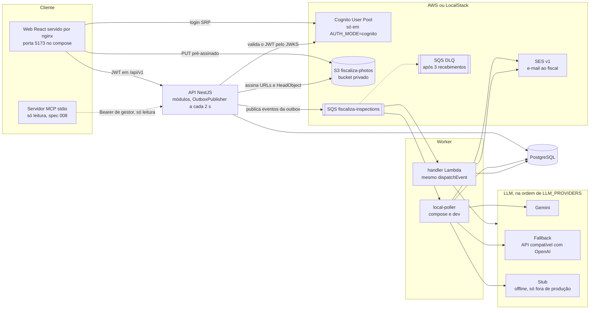

# Arquitetura

## O que mostrar na entrevista

API e worker são dois processos que só se falam pela mensagem no SQS e pelas tabelas do banco. O arquivo nunca passa pela API: o navegador envia a foto direto ao S3 por uma URL assinada. O publicador da outbox vive dentro da API, e o worker (poller no compose, Lambda na AWS) grava o relatório e a notificação no banco.

## Notas de conferência com o código

- O handler Lambda existe e é testado, mas o repositório não traz o deploy dele. No compose roda o `local-poller`, com o mesmo `dispatchEvent`.
- O servidor MCP (`apps/mcp`, spec 008) roda por stdio no cliente MCP, fora do compose, e só lê a API com um token de gestor.
- No ambiente local não há Cognito (`AUTH_MODE=local`, tokens de teste fixos) e o worker usa o provedor `stub` por padrão.
- O web do compose é uma imagem nginx com o build do Vite. O `PROJETO.md` (seção 22) cita a Vercel para o deploy opcional.
- O envio de e-mail usa SES v1 (`@aws-sdk/client-ses`) porque o LocalStack da comunidade não implementa o v2.
