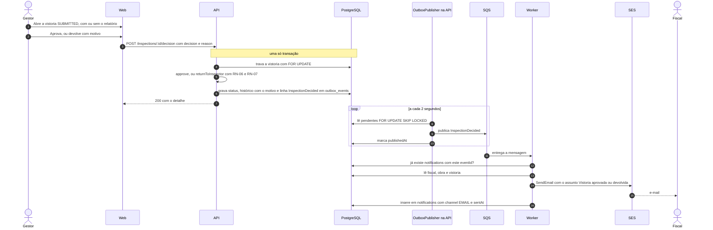

# Decisão do gestor

## O que mostrar na entrevista

A decisão usa o mesmo mecanismo do envio: status, histórico e evento na mesma transação, com o publicador levando o evento ao SQS. A API não lê o relatório da IA para decidir (RN-08): o gestor decide com ou sem ele, e o sistema só registra quem decidiu. A tabela `notifications`, com `eventId` único, é o que impede o worker de notificar duas vezes o mesmo evento.

## Notas de conferência com o código

- Há uma janela honesta: se o worker cair depois do `SendEmail` e antes de gravar em `notifications`, o evento volta e o e-mail sai de novo. Foi aceito, um e-mail repetido é melhor que um perdido.
- A notificação é só por e-mail. O `PROJETO.md` (seção 5.2) fala em "e-mail ou aviso no sistema", e o aviso no sistema não existe.
- O consumidor "Notificações" do `PROJETO.md` é o próprio worker, no caso de uso `NotifyInspectorUseCase`, e não um serviço separado.
- A rota é `/inspections/:id/decision` com `{ decision: APPROVE | RETURN, reason }`. O `PROJETO.md` usa `/vistorias/:id/decisao` com `APROVAR` e `DEVOLVER`.
- O assunto do e-mail é "Vistoria aprovada" ou "Vistoria devolvida", e o motivo vai no texto. A tela de decisão do web (spec 005, T15.8) ainda não existe nesta versão.
