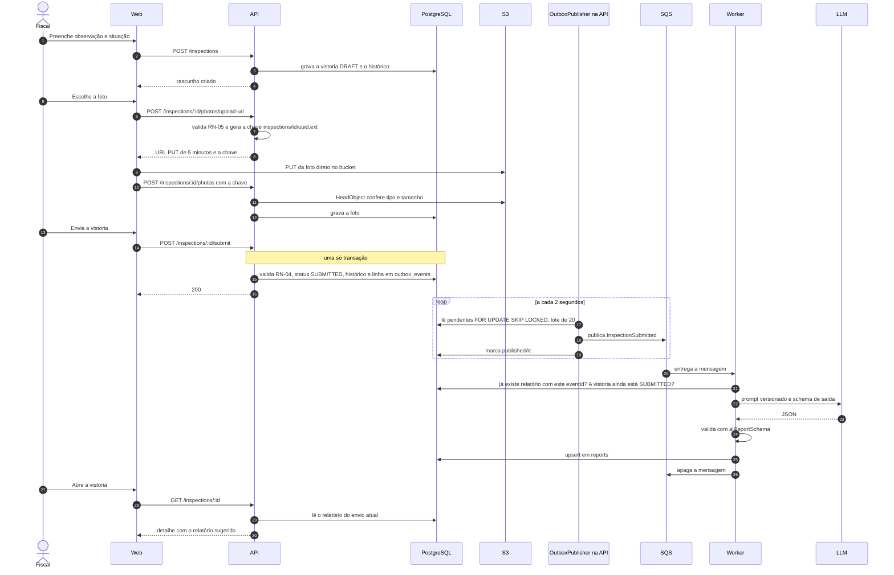

# Envio da vistoria

## O que mostrar na entrevista

O ponto central é o passo 15: a mudança de status e o evento nascem na mesma transação, então nunca existe vistoria enviada sem pedido de relatório. Quem leva o evento ao SQS é o publicador (passos 17 a 19), e como a entrega é pelo menos uma vez, o worker confere o `eventId` antes de gastar o LLM. Mostre também o que a API não faz: não recebe o arquivo (passos 9 a 11) e não chama o LLM.

## Notas de conferência com o código

- As rotas estão em inglês, como no código (`/inspections/:id/submit`). O `PROJETO.md` usa `/vistorias/:id/enviar`, e a chave no S3 é `inspections/<id>/<uuid>.<ext>`, não `vistorias/...`.
- No diagrama do `PROJETO.md` o worker grava o relatório com uma seta para a API. No código ele grava direto na tabela `reports`, pelo cliente Prisma gerado do schema da API.
- Se todos os provedores de LLM falham, a mensagem volta para a fila e, depois de 3 recebimentos, vai para a DLQ. A API continua respondendo.
- Num reenvio depois de devolvida, a API esconde o relatório antigo até o novo chegar.
- A tela de vistorias do web (spec 003, T15) ainda não existe nesta versão. A API já cumpre o fluxo, e a coluna Web mostra o que a tela fará.
