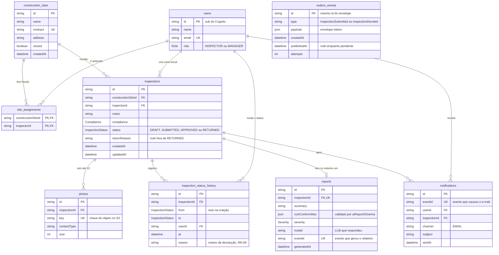

# Modelo de dados

## O que mostrar na entrevista

`outbox_events` é a única tabela sem relação com as outras, de propósito: o evento carrega o envelope inteiro e nasce na mesma transação da mudança. `reports` e `notifications` são escritas pelo worker e têm `eventId` único, que é o que torna os consumidores idempotentes. `reports` tem uma linha por vistoria (`inspectionId` único), então um reenvio depois de devolvida sobrescreve o relatório anterior.

## Notas de conferência com o código

- Nomes em inglês, pelo glossário da constitution: `Obra` é `construction_sites`, `ObraFiscal` é `site_assignments`, `HistoricoStatus` é `inspection_status_history`, `OutboxEvento` é `outbox_events`.
- O `PROJETO.md` (seção 11) está desatualizado em relação ao schema: faltam `Notification`, `InspectionStatusHistory.reason`, `Report.eventId`, `Report.generatedAt` sem default, `OutboxEvent` com índice `(publishedAt, createdAt)`, a relação de `User` com vistorias e histórico, e os índices trigram de `construction_sites`.
- `Photo`, `InspectionStatusHistory`, `Report` e `Notification` apagam em cascata com a vistoria. `SiteAssignment` apaga em cascata com a obra.
- Os valores dos enums estão em inglês: `Role { INSPECTOR, MANAGER }`, `Compliance { COMPLIANT, NON_COMPLIANT }`, `InspectionStatus { DRAFT, SUBMITTED, APPROVED, RETURNED }` e `Severity { LOW, MEDIUM, HIGH }`.
- O diagrama é gerado à mão a partir de `apps/api/prisma/schema.prisma`. Se o schema mudar, o diagrama precisa ser atualizado.
